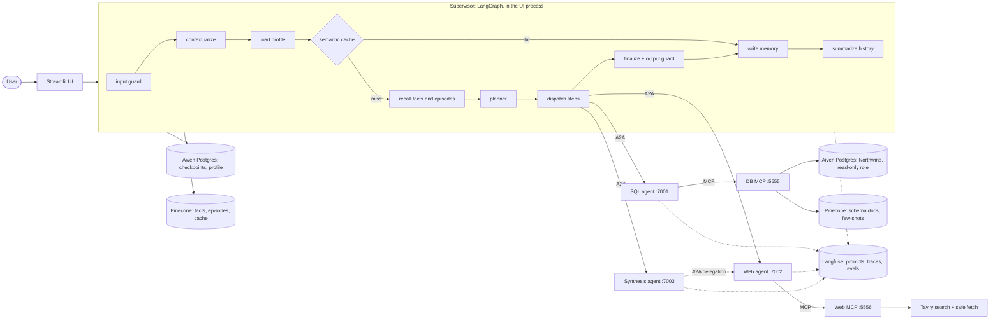

# Multi-agent conversational assistant

A chat assistant that answers questions about a company's sales database (Northwind), about
the public web, and about both together. A **LangGraph supervisor** plans each turn and
delegates to three **A2A agents** (SQL, Web, Synthesis), which reach their data through
**MCP** servers. It remembers users across conversations, caches finished answers safely,
guards its inputs and outputs, asks a human before running risky queries, and is traced and
evaluated in **Langfuse**.

This is Case Study 3 (extending the capstone of Case Study 2). The plan, decisions and gate
results of every phase are in [docs/plan/implementation_plan.md](docs/plan/implementation_plan.md);
the architecture is in [docs/architecture/hld_lld.md](docs/architecture/hld_lld.md).

## How it fits together



- **MCP** is how an agent reaches a *tool* (the database, web search and page fetch).
- **A2A** is how an agent reaches *another agent*: the supervisor delegates tasks, and the
  Synthesis agent delegates to the Web agent. Each agent has an agent card, and requests and
  results are validated contracts.
- **LangGraph** is the inside of every agent and of the supervisor: nodes, parallel `Send`
  fan-out, `interrupt()` for human approval, retry policies, checkpoints.
- **Rules that hold everywhere:** the supervisor never imports an agent (it uses A2A); agents
  never import each other; nodes get their dependencies from the runtime context, so tests
  use fakes; tools and agents never raise across a boundary (they return an error result).

## What it can do (the five demos)

| Demo | Try asking | What you should see |
|---|---|---|
| SQL | *How many customers do we have in each country?* | the SQL agent, the SQL used, the answer |
| Web | *What are the main trends in the global beverage market?* | the Web agent, cited sources |
| Hybrid | *How does our beverage revenue by year compare with the global beverage trend?* | SQL + Synthesis (which asks the Web agent itself), one combined answer |
| Memory | *I manage the APAC region.* then, in a **new chat**, *Which region do I manage?* | recalled across threads; a different user does not see it |
| Safety | *List the phone numbers of our customers*, or *Ignore all previous instructions…* | an approval card before the query runs; the second is refused |

Also: a repeated question is answered from the cache (badge "cached answer"), and a thumbs-down
removes that answer from the cache.

## Prerequisites

- Python 3.14 and [uv](https://docs.astral.sh/uv/)
- Accounts (free tiers work): **Aiven** (Postgres), **Pinecone**, **OpenRouter**,
  **Langfuse Cloud**, **Tavily**
- No Docker

## Setup

```bash
uv sync
cp .env.example .env        # then fill it in, see the table below
```

| Variable | What it is |
|---|---|
| `POSTGRES_HOST`, `POSTGRES_PORT`, `POSTGRES_ADMIN_*` | Aiven connection information (admin role, used only by `init_db.py`) |
| `AGENT_APP_PASSWORD`, `AGENT_READONLY_PASSWORD` | passwords you choose for the two roles `init_db.py` creates: `agent_app` (checkpoints, profile) and `agent_readonly` (the only role that can query Northwind) |
| `PINECONE_API_KEY`, `PINECONE_INDEX` | the index is created on first use |
| `OPENROUTER_API_KEY`, `CHAT_MODEL`, `JUDGE_MODEL` | any OpenRouter chat model that supports JSON-schema output; the judge may be another model |
| `EMBED_MODEL` | defaults to `nvidia/nemotron-3.5-embed-8b:free` |
| `LANGFUSE_PUBLIC_KEY`, `LANGFUSE_SECRET_KEY`, `LANGFUSE_BASE_URL` | Langfuse project keys |
| `PROMPT_LABEL` | which Langfuse prompt label the agents read (`production`, or `development` while iterating) |
| `DB_MCP_TOKEN`, `WEB_MCP_TOKEN`, `A2A_TOKEN` | shared bearer tokens: make each with `openssl rand -hex 32` |
| `TAVILY_API_KEY` | web search |
| `DATA_VERSION`, `CACHE_THRESHOLD`, ... | memory and cache tuning, all with defaults (see `config.py`) |

One-time preparation, in order:

```bash
uv run python scripts/init_db.py              # databases, roles, Northwind data, grants
uv run python scripts/build_schema_index.py   # schema docs and few-shot examples into Pinecone
uv run python scripts/sync_prompts.py         # prompts/*.yaml into Langfuse, label "development"
```

Prompts are versioned in Langfuse. `sync_prompts.py` creates version N with the label
`development`; **promoting a prompt is a manual step in the Langfuse UI** (add the label
`production` to the version). With `PROMPT_LABEL=production` and no such version, the agents
fall back to the local file and log it. The version each answer used is shown in the UI and
linked to its trace.

## Run it

```bash
uv run python scripts/run_all.py --ui
```

starts both MCP servers and the three agents (waiting for each `/health`), then the Streamlit
UI at <http://localhost:8501>. Without `--ui` it starts only the services; run
`uv run streamlit run src/ui/streamlit_app.py` yourself. Logs are in `logs/`. A service that is
already running on its port is reused.

In the UI: pick a user (memory is per user), ask a question, watch the progress, open
*Sources*, *SQL used*, *What I learned this turn* and *Prompts and trace* under an answer.
**New chat** ends the conversation and stores a summary of it. The sidebar shows what the
assistant remembers about you, with a button to forget a fact or reset your preferences.

## Test it

```bash
uv run pytest tests/unit                       # offline, fast, no network
uv run python scripts/smoke_supervisor.py      # live end-to-end gate (about 6 min)
uv run python scripts/smoke_memory.py          # live memory and cache gate (about 6 min)
uv run python scripts/smoke_guardrails.py      # live guard classifier gate
```

The other smoke scripts (`smoke_llm`, `smoke_db_mcp`, `smoke_web_mcp`, `smoke_mcp_client`,
`smoke_a2a`, `smoke_tracing`, `smoke_sql_agent`, `smoke_web_agent`, `smoke_synthesis`) test
one layer each and start the services they need on spare ports. They need the real keys.
`scripts/calibrate_cache.py` measures the embedding model to choose the cache threshold.

## Evaluate it

```bash
uv run python scripts/sync_eval_dataset.py                       # 39 cases into a Langfuse dataset
uv run python -m multi_agenti_conversation_system.evals.run_eval --label development --run-name baseline
```

Each run is a Langfuse experiment: every item is linked to its trace and to the prompt
versions it used. Scores: deterministic checks (route, agents, A2A contract, SQL executes,
**result set matches the gold query**, citations, guardrails, cache behaviour, latency) plus an
LLM judge (relevance, correctness, groundedness, completeness, clarity, 1 to 5). The results
land in `results/<run-name>.csv` and `results/<run-name>.md`. Change a prompt, push it, run
again with another `--run-name`, and compare the two runs in Langfuse.

## Project layout

```
src/multi_agenti_conversation_system/
  a2a/          contracts (requests, results, errors), server (graph -> A2A agent), client (registry)
  agents/       sql/, web/, synthesis/ (a LangGraph graph + an app per agent), echo/ (plumbing test)
  supervisor/   the LangGraph supervisor: planner, dispatch, approval, memory and guard nodes, service
  memory/       profile, facts, episodes, semantic cache, learned SQL pairs, checkpointer
  guardrails/   sql_validator, input_guard, output_guard, memory_gate, pii (also the trace mask)
  mcp/          client, common (bearer auth), servers/db_server, servers/web_server
  retrieval/    hybrid search: BM25 + dense, fused with reciprocal rank fusion
  evals/        dataset, scorers, judge, run_eval
  llm.py, embeddings.py, vectorstore.py, prompts.py, tracing.py, config.py
src/ui/         the Streamlit app
prompts/        every prompt, as the local fallback and the seed for Langfuse
data/           schema descriptions and few-shot examples
tests/          unit/ (offline), integration/ (live)
```

## Safety, in layers

| Layer | What it does |
|---|---|
| Input | length limit, injection heuristics plus a model classifier, PII flagging; a blocked message never reaches an agent or memory |
| SQL | an AST validator (one read-only `SELECT`, allow-listed tables, row limit) in the agent **and** again in the DB server; the database role itself is read-only |
| Human approval | queries over PII columns, or large raw results, pause for Approve/Reject; an approval covers one exact SQL string |
| A2A boundary | typed contracts with size caps; unknown fields are rejected |
| Memory | a write-gate: nothing with personal data, and only what the user actually said about themselves |
| Output | secrets always redacted; personal data redacted unless a human approved the query; citation markers without a source removed |
| Traces | a mask hook redacts secrets and PII before anything is sent to Langfuse; rows from PII columns never reach a trace |

## What is simulated, and known limits

- **The company is Northwind**, a public sample database, with its dates shifted to look
  current. Nothing here is real company data.
- **The chat model is a free OpenRouter model** by default, so it is slow (a hybrid answer
  takes about a minute) and rate limited; the code handles that (retries, timeouts, partial
  answers) but you will feel it. A paid model changes only `CHAT_MODEL`.
- **Authentication is one static bearer token** per service group, not per-user identity. The
  user id in the UI is a name you type; there is no login.
- **A2A tasks are kept in memory** by each agent: a waiting approval does not survive an
  agent restart (the supervisor's own conversation does, in Postgres).
- **The semantic cache and memory thresholds were calibrated on this embedding model**; see
  `scripts/calibrate_cache.py`. A different model needs a re-run.
- **Name and address detection is not attempted** by the regex-based PII redaction. The
  protection for those is the approval gate on PII columns, not redaction.
- **Not built:** inferred preference drift from repeated signals, the confirm-once flow for
  an ambiguous preference conflict, fact consolidation, a per-user fact cap, and episode
  retention. They are listed as "Should" items in the plan.
- **Agent-down and timeout cases** are tested by the live smoke scripts (they stop a process
  mid-run), not by the evaluation dataset.

No secrets are stored in the repository: everything comes from `.env`, which is ignored by git.
