# HLD and LLD: Multi-Agent Conversational Assistant (CS2 + CS3)

Diagrams for understanding the system. **The plan (`docs/plan/implementation_plan.md`) is the source of truth.** If the two disagree, the plan wins and this file gets updated.

Legend: green = built and tested, yellow = planned (phase in brackets).

---

# Part 1: High-level design (HLD)

## 1.1 System architecture

What runs where, and how the pieces talk.

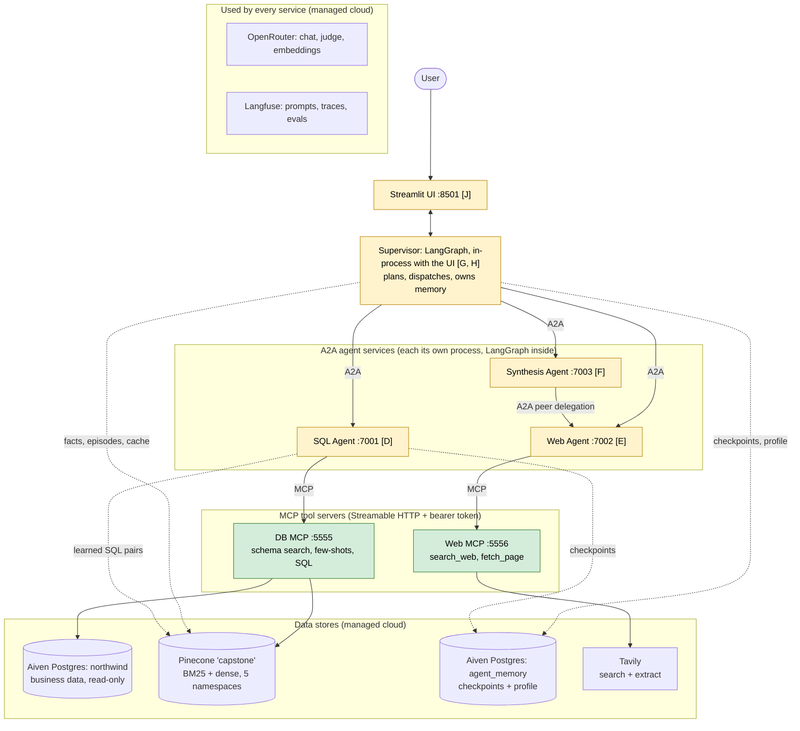

Not drawn, to keep it readable: every service calls OpenRouter (LLM, embeddings) and Langfuse (prompts, traces). Dotted lines are memory; solid lines are calls.

**The two protocols, in one line each:**
- **A2A** is how *agents talk to agents*: the supervisor delegates tasks, and Synthesis delegates to Web.
- **MCP** is how *agents use tools*: databases and the web are only reached through MCP servers.

## 1.2 Storage split

| Store | Holds | Who writes | Who reads |
|---|---|---|---|
| Aiven `northwind` | business data (orders, products, customers…) | nobody (read-only) | DB MCP server, as `agent_readonly` |
| Aiven `agent_memory` | conversation checkpoints, user profile | supervisor, SQL agent (`agent_app`) | same |
| Pinecone `schema_docs`, `sql_seed_examples` | seed knowledge (not memory) | `build_schema_index.py`, offline | DB MCP server |
| Pinecone `user_facts`, `episodes`, `semantic_cache` | long-term memory and cache | supervisor (facts, episodes, cache), SQL agent (SQL pairs) | same |
| Langfuse | prompts, traces, datasets, scores | `sync_prompts.py`, every service, evals | every service (prompts), you (UI) |

## 1.3 One hybrid question, end to end

"How did our beverage sales do last quarter compared with the market trend?"

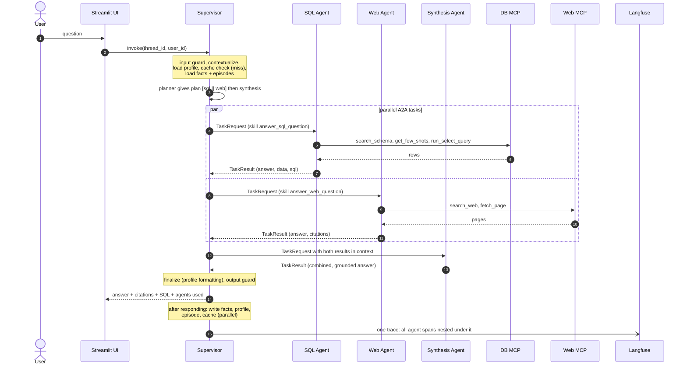

## 1.4 What each CS3 requirement maps to

| CS3 requirement | Where it lives |
|---|---|
| Real A2A collaboration | supervisor → agents, plus Synthesis → Web peer delegation (§2.3–2.6) |
| Semantic memory lifecycle | facts with supersede, expiry, consolidation; cache with entity keys (§2.8) |
| Prompt-as-a-service | Langfuse prompts with labels, local YAML fallback (§2.10) |
| Evaluation framework | Langfuse datasets + experiments, deterministic scorers + LLM judge (§2.11) |
| Guardrails (CS2 + CS3) | seven layers along the request path (§2.9) |

---

# Part 2: Low-level design (LLD)

## 2.1 Supervisor graph [G, H, I] (built)

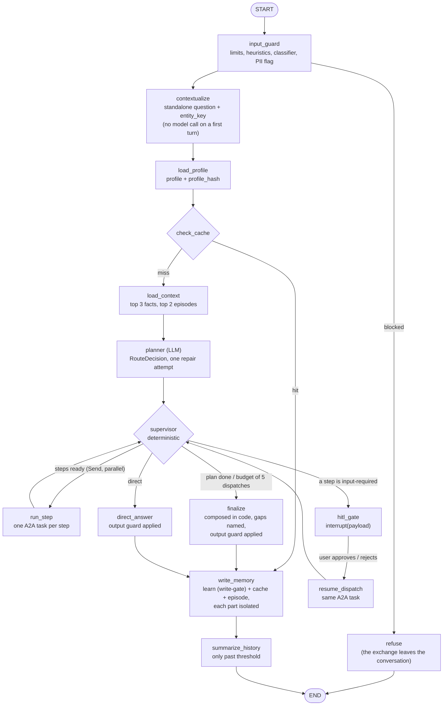

There is **no re-planning after a failed step** (decided in Phase G): the gap is named in a partial answer instead. The output guard is not a node of its own: it runs inside the function that builds every answer, so the text shown, checkpointed and cached is the guarded one.

**Why three HITL nodes:** when a run resumes after `interrupt()`, LangGraph re-runs that whole node. If `dispatch` also interrupted, resuming would send the SQL task a second time (G22).

**Plan shapes the planner can return:**

| Route | Plan |
|---|---|
| web | `[web]` |
| sql | `[sql]` |
| hybrid | `[sql ∥ web] → synthesis` |
| direct (chit-chat) | `[]` |
| internal vs market | `sql → synthesis`, and Synthesis fetches web data itself (the delegation demo) |

## 2.2 Supervisor state [G, H, I] (built, `supervisor/state.py`)

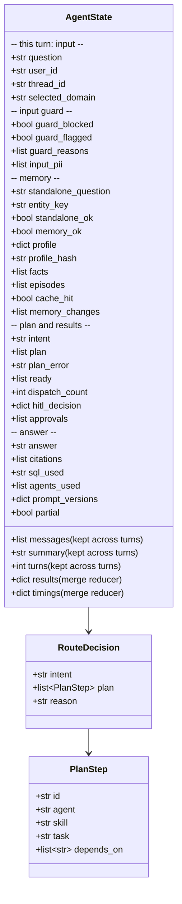

`graph.turn_input` resets everything marked "this turn" on each new turn (the accumulating fields with `Overwrite`); `messages`, `summary` and `turns` are restored from the checkpoint by the thread id.

## 2.3 A2A contract (built)

`a2a/contracts.py`. Each model travels as ONE A2A `Part` holding its JSON text (media type `application/json`), validated by Pydantic on **both** ends. Not a `DataPart`: that is a protobuf `Value`, which turns every number into a float (`product_id` 100 becomes 100.0). `trace_ctx` is not in these models: it travels in the A2A message metadata, so a resume keeps the trace. The card publishes the JSON schemas in an A2A extension.

The diagram below predates the final model; `a2a/contracts.py` is authoritative (it adds `ResumeRequest`, `TaskRequest.data`, `TaskResult.a2a_task_id` / `context_id`, and the error codes `bad_request` and `internal`).

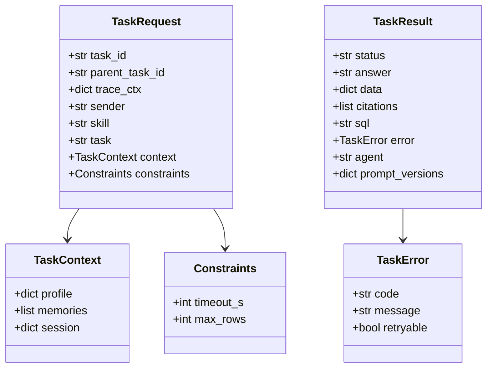

`TaskError.code` is one of `timeout`, `unavailable`, `invalid_output`, `failed`, `blocked`, `rejected`.

**A2A task states, as our agents use them:**

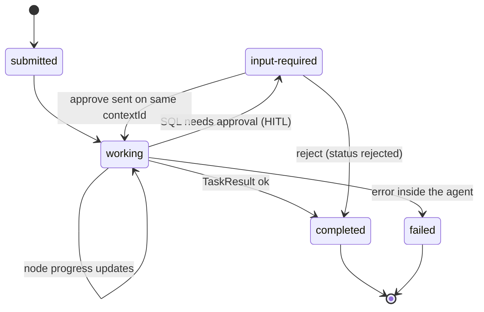

## 2.4 A2A plumbing: discovery and failure handling (built)

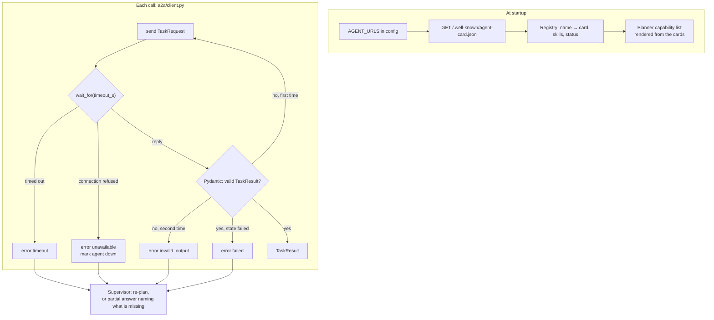

The server side (`a2a/server.py`) is one generic executor. It wraps any compiled LangGraph graph, turns node progress into `working` updates, and turns an `interrupt()` into `input-required`. Every agent reuses it.

## 2.5 HITL across A2A [D, G]

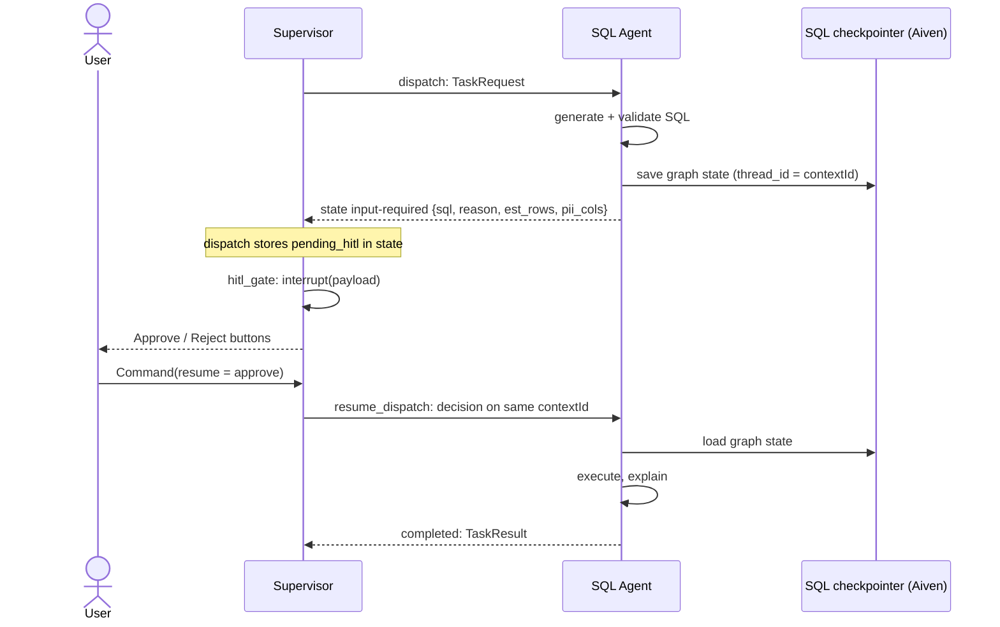

**Known limitation:** the A2A task store is in memory. If the SQL agent restarts mid-approval, the task is lost, even though its LangGraph checkpoint survives.

## 2.6 Agent graphs [D, E, F]

### SQL Agent :7001, skill `answer_sql_question`

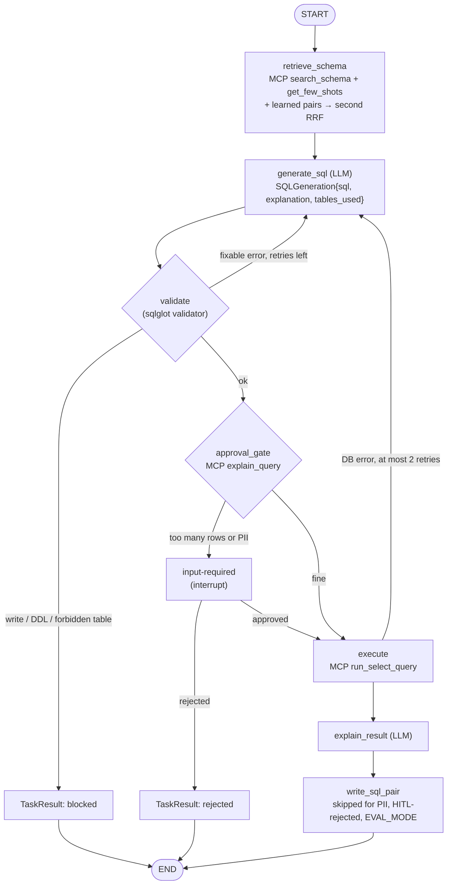

### Web Agent :7002, skill `answer_web_question`

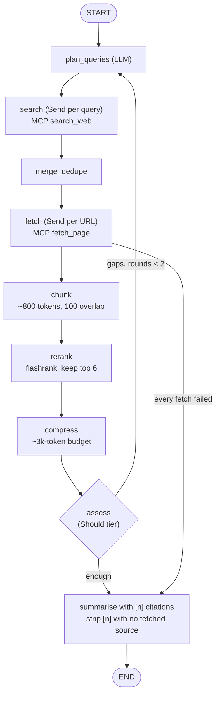

If every fetch fails, the agent answers from the search snippets and flags low confidence.

### Synthesis Agent :7003, skill `synthesise`

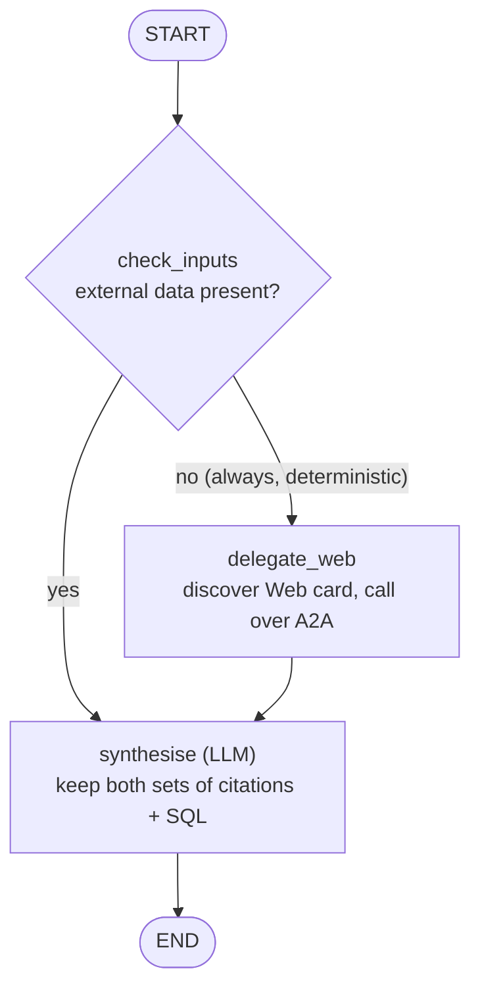

The delegation rule is deterministic so the demo takes the same path every run. An LLM-decided trigger is too unreliable live.

## 2.7 MCP layer: tools, auth and guards (built)

```mermaid
flowchart LR
    subgraph client["mcp/client.py (built)"]
        om["open_mcp(['db','web'])<br/>one MCPAdapter per server<br/>held open for the caller's lifetime"]
    end

    subgraph dbs["DB MCP :5555 (built)"]
        a1["BearerAuth<br/>(/health exempt)"]
        t1["list_tables, get_schema<br/>search_schema, get_few_shots<br/>explain_query, run_select_query"]
        g1["sql_validator: one SELECT,<br/>no DDL/DML, LIMIT clamp,<br/>table allowlist, PII columns"]
        r1["role agent_readonly<br/>statement_timeout 5s"]
        a1 --> t1 --> g1 --> r1
    end

    subgraph wbs["Web MCP :5556 (built)"]
        a2["BearerAuth"]
        t2["search_web, fetch_page"]
        g2["token-bucket rate limits<br/>SSRF guard: public IPs only,<br/>each redirect re-checked (max 3),<br/>10s timeout, 2MB cap"]
        x2["trafilatura,<br/>Tavily Extract fallback"]
        a2 --> t2 --> g2 --> x2
    end

    om -->|"Authorization: Bearer DB_MCP_TOKEN"| a1
    om -->|"Authorization: Bearer WEB_MCP_TOKEN"| a2
    r1 --> nw[("northwind")]
    t1 --> pc[("Pinecone")]
    x2 --> tv["Tavily"]

    classDef built fill:#d4edda,stroke:#2e7d32,color:#000
    class om,a1,t1,g1,r1,a2,t2,g2,x2 built
```

Tools never raise across the boundary. They return `{"ok": false, "error": "..."}`, so the agent can read the message and adapt.

## 2.8 Hybrid retrieval (built)

Used by `search_schema` and `get_few_shots`, and reused for learned SQL pairs.

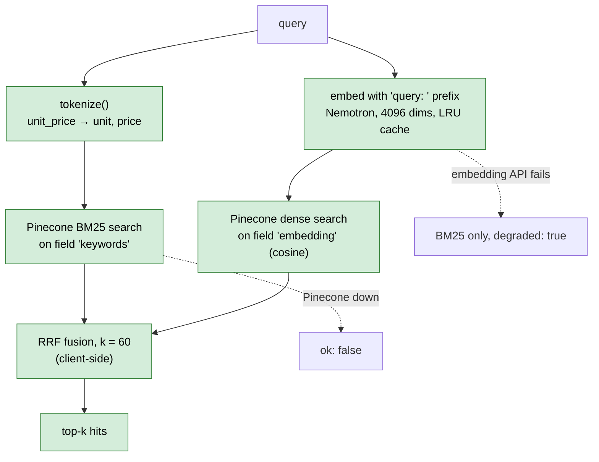

The two searches run in parallel.

## 2.9 Memory [G, H]

### Reads and writes during one turn

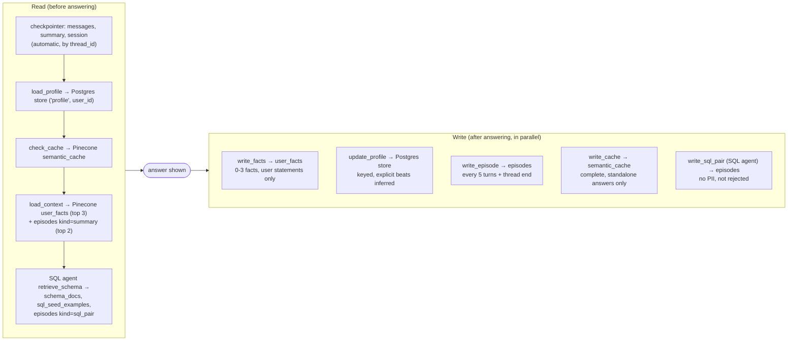

**Where a statement goes:** a preference ("always short answers") goes to the profile, a fact ("I manage APAC") to `user_facts`, and a one-off ("this once in USD") to the session only.

### Fact lifecycle (supersede, never overwrite)

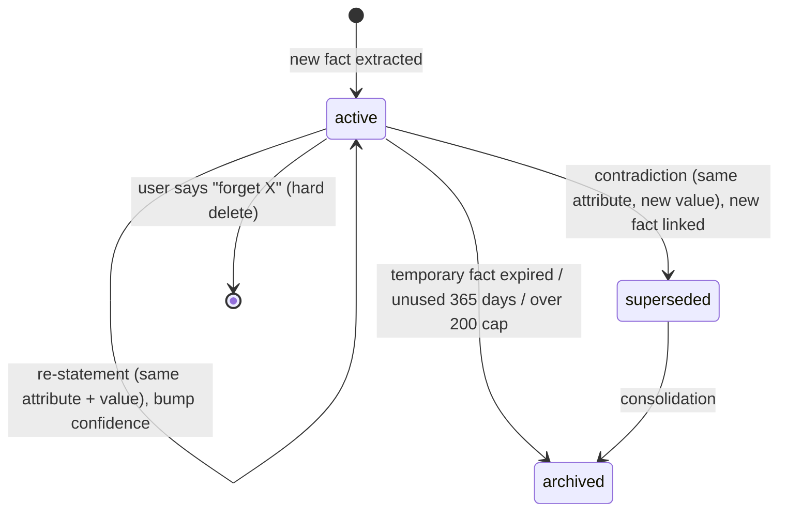

Only `active` facts are retrieved. They're ranked by `similarity × (0.7 + 0.3 × freshness)` and injected with their date, e.g. "Manages APAC region (stated 2026-10-02)".

### Semantic cache hit test (the `product_id` 100 vs 150 problem)

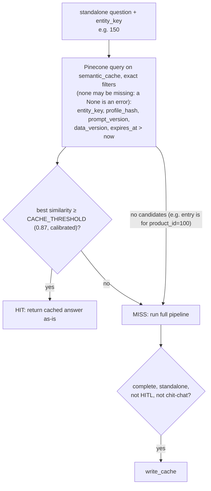

Similarity alone would return product 100's answer for product 150. The exact `entity_key` filter makes that impossible.

## 2.10 Guardrail layers along the request path [I] (all built)

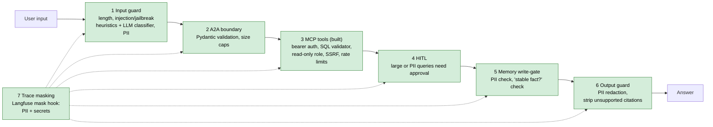

## 2.11 Prompts and tracing through Langfuse (built)

### Prompt lifecycle

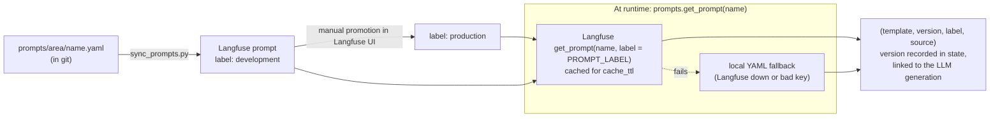

Changing behaviour means editing the prompt in Langfuse and promoting it. No code change or redeploy.

### Trace propagation across services

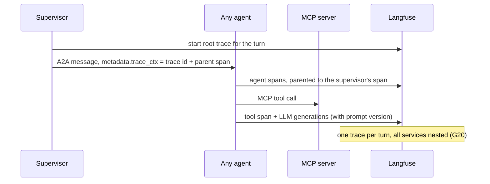

## 2.12 Evaluation pipeline [K] (built, not yet run)

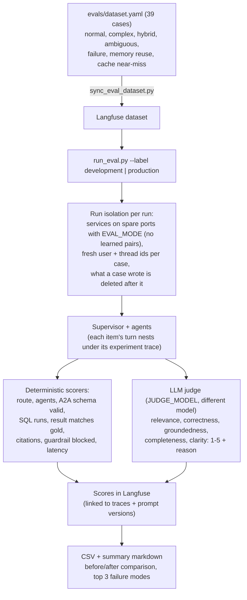

## 2.13 Code layout and import rules

```mermaid
flowchart TD
    ui["src/ui/streamlit_app.py"] --> sup["supervisor/"]
    sup --> mem["memory/"]
    sup --> a2ac["a2a/client.py"]
    ag["agents/sql, web, synthesis"] --> a2as["a2a/server.py"]
    ag --> mcpc["mcp/client.py"]
    ag --> a2ac
    a2ac & a2as --> con["a2a/contracts.py"]
    mcpc -.->|"HTTP only"| srv["mcp/servers/db_server, web_server"]
    srv --> ret["retrieval/hybrid.py"]
    srv --> gr["guardrails/"]
    sup --> gr
    sup & ag & srv --> base["config, llm, embeddings,<br/>vectorstore, prompts, tracing"]

    sup -. "never imports" .-x ag
    ag -. "never import each other" .-x ag
```

- **The supervisor reaches agents only over A2A.** Agents reach tools only over MCP. Each server and agent is its own process.
- **Nodes get their dependencies from `Runtime[AppContext]`** (models, MCP tools, A2A registry, memory, prompts), never from globals.

## 2.14 Processes and ports

| Process | Port | Phase | Status |
|---|---|---|---|
| DB MCP server | 5555 | 2, 2b, A | built |
| Web MCP server | 5556 | B | built |
| Echo test agent (A2A) | 7009 | C | built (plumbing test only) |
| SQL Agent (A2A) | 7001 | D | built |
| Web Agent (A2A) | 7002 | E | built |
| Synthesis Agent (A2A) | 7003 | F | built |
| Supervisor (library, `supervisor/service.py`; runs in the UI process) | none | G | built |
| Streamlit UI | 8501 | J | written, not yet tried in a browser |

`scripts/run_all.py` starts everything and waits for each `/health` and agent card.
