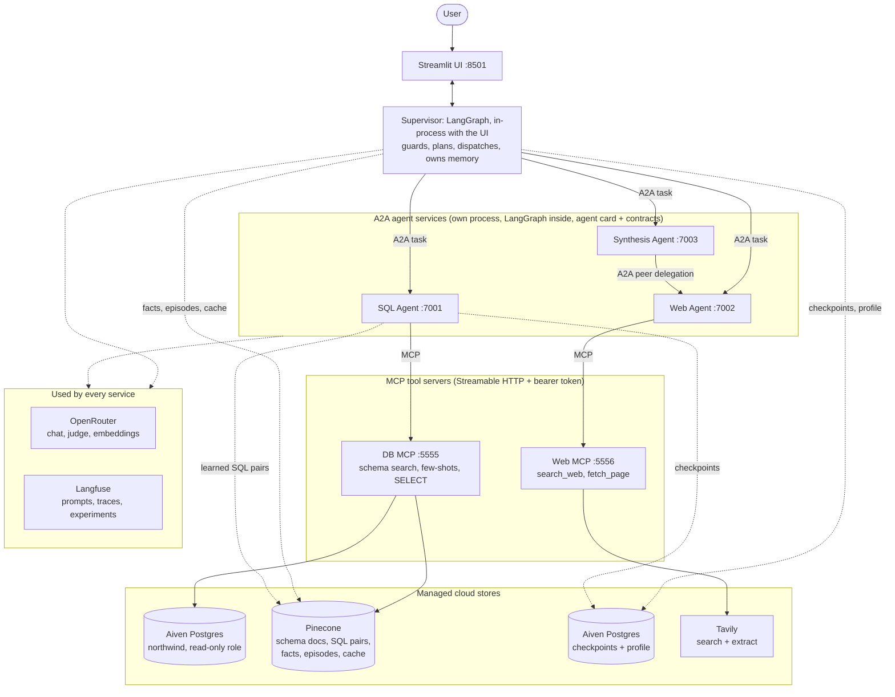
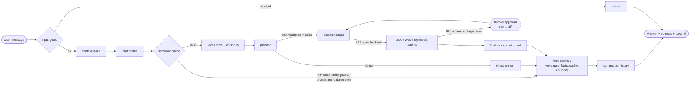
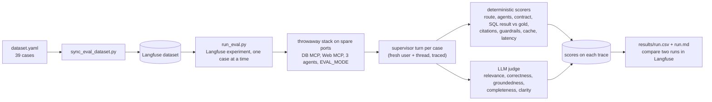

# Architecture and flow diagrams

Three diagrams: the system, one turn through the supervisor, and the evaluation flow. They are
Mermaid, so they render on GitHub and in VS Code's Markdown preview. For a PDF or slide image,
paste a block into <https://mermaid.live> and export, or print this page to PDF from the
preview. The longer design (state, contracts, memory, guard layers) is in
[docs/architecture/hld_lld.md](../architecture/hld_lld.md).

## 1. System architecture

Solid lines are calls; dotted lines are storage and shared services. MCP is how an agent
reaches a tool; A2A is how an agent reaches another agent.

## 2. One turn through the supervisor

## 3. Evaluation flow

